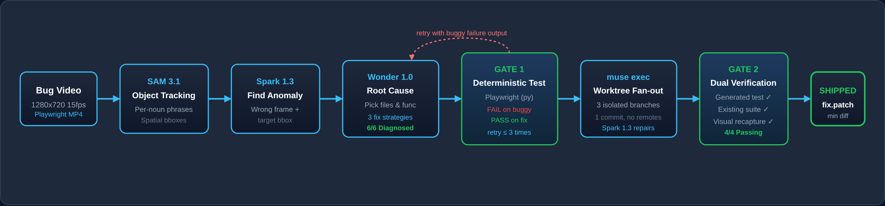
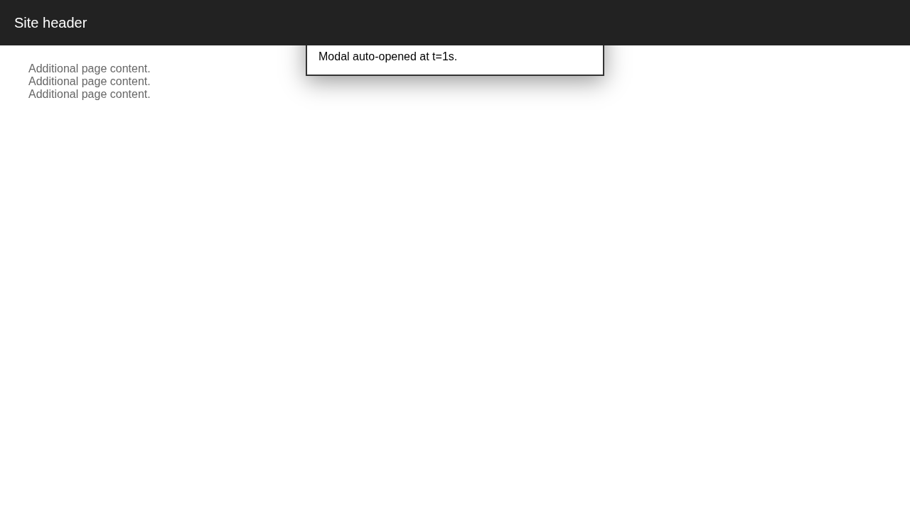
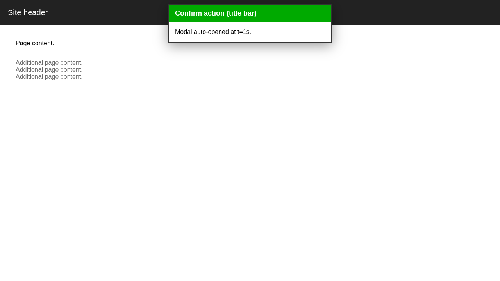
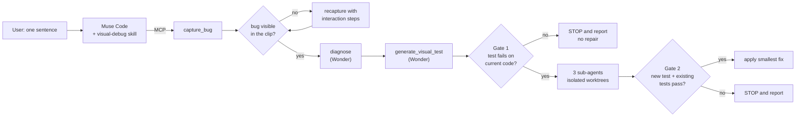
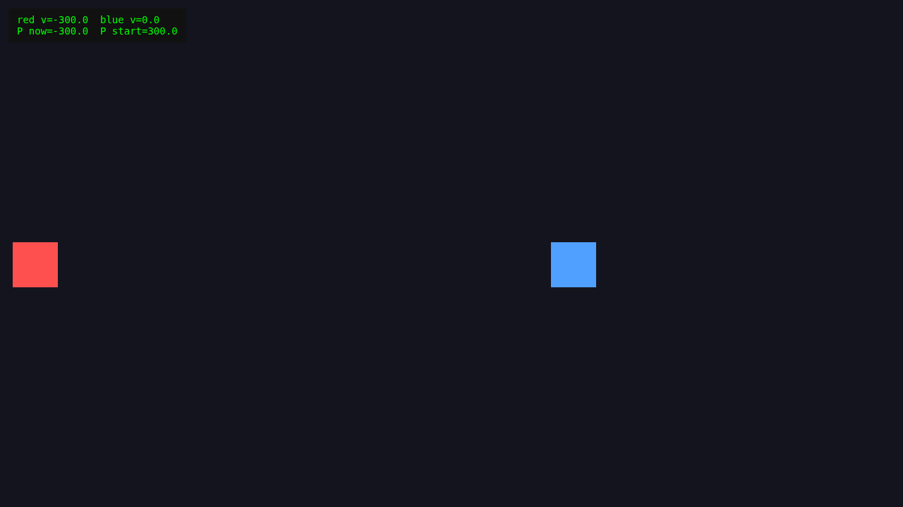
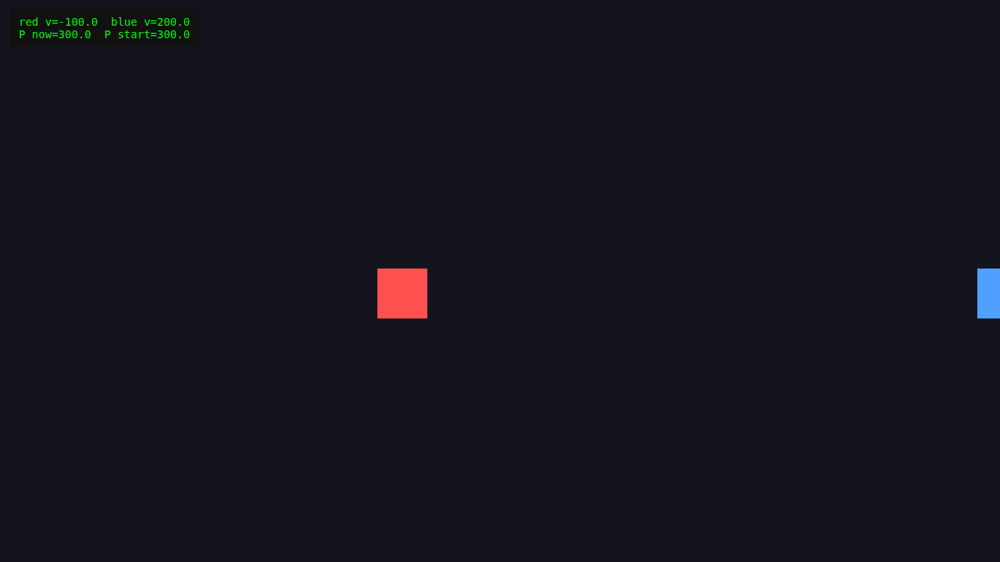

<div align="center">

# VisioPatch

### Muse Code can't see. VisioPatch gives it eyes.

**An agent that watches a visual bug, proves it with a failing test, and ships a verified fix, all from one sentence.**

[](#built-on-meta)
[](#built-on-meta)
[](#built-on-meta)
[](#built-on-meta)
[](#quick-start)
[](LICENSE)

Meta Global AI Developer Hackathon · Indie track · Problem statement: **Push the Frontier**

</div>



---

## The problem

Coding agents read code and test output. They can't see the screen. A popup that slides under a header, a font that gets cropped, a physics collision that loses momentum: every text-based test passes, the user sees something broken, and the agent has nothing to work with.

**VisioPatch gives Muse Code a visual loop.** It records the page, sees what's wrong, finds the cause in the source, writes a test that proves the bug exists, tries several fixes in parallel, and only ships a fix that turns that test green without breaking anything else.

---

## See it work: one sentence to a verified fix

A fresh **Muse Code** session, opened in a one-commit demo repo it has never seen, gets one sentence from the user:

```text
when I scroll down, the popup's top part gets hidden, fix it
```

From there it works on its own, through the `visual-debug` skill and the VisioPatch MCP tools:

| # | Step | What the agent did |
|---|---|---|
| 1 | `capture_bug` | Served the repo itself and recorded the page, scrolling the way the report describes |
| 2 | `track_objects` · `find_anomaly` | SAM 3.1 tracked what it could find; Muse Spark 1.3 compared the clip with the report |
| 3 | `diagnose` | Muse Wonder named the cause: `transform: translateZ(0)` on `<main>` traps the popup under the sticky header |
| 4 | `generate_visual_test` | **Gate 1:** the generated Playwright test **failed on the current code** (popup title top moved from 76 px to −224 px at a 300 px scroll), proving the bug |
| 5 | `repair_and_verify` | Three Muse Code sub-agents tried three strategies in isolated git worktrees |
| 6 | **Gate 2** | All three passed; the smallest was applied, and the test now passes |

| Candidate | Strategy | Lines | Gate 2 |
|---|---|---|---|
| **s1** | Viewport-fixed popup, trapping transform removed | **4** | ✅ pass, **picked** |
| s2 | Move the popup out of `<main>` into `<body>` | 14 | ✅ pass |
| s3 | Scroll-synced positioning in JavaScript | 17 | ✅ pass |

| Before (benchmark screenshot) | After a verified fix (benchmark screenshot) |
|---|---|
|  |  |

No human touched the code. Nothing was hand-edited before Gate 2.

---

## Built on Meta

Every model call in VisioPatch goes to a Meta model, and the agent that drives it is Meta's own coding agent.

| Meta product | What VisioPatch uses it for | Why it's the right tool |
|---|---|---|
| **Muse Code** | The agent the user talks to. It loads the `visual-debug` skill, calls the VisioPatch **MCP server**, and runs repair candidates as `muse exec` sub-agents with `--subagent-worktree-isolation` | MCP plus skills let us add a whole new sense to an existing agent without forking it; worktree isolation lets three fixes run side by side safely |
| **SAM 3.1** | Video object tracking from a noun phrase (`visiopatch/perceive.py`) | Turns pixels into per-frame object tracks, so the pipeline reasons about where things are and how they move |
| **Muse Spark 1.3** | Video understanding: finds the frame and region that look wrong, proposes nouns for SAM (`visiopatch/analyze.py`); also writes the repair candidates | Native video input and low cost make it the eyes that run on every clip |
| **Muse Wonder** | Picks suspect files, diagnoses the root cause with 3 fix strategies, and writes the deterministic Playwright test (`visiopatch/rootcause.py`, `visiopatch/testgen.py`) | The deep-reasoning step: it connects "this looks wrong" to the exact line of code, then turns it into a pass/fail check |

All API calls go through `https://api.meta.ai/v1` (OpenAI-compatible). Repair candidates run on the Muse Code subscription, so a full repair costs $0 in API credits.

---

## Why it's agentic

VisioPatch isn't a script that calls a model once. It's an agent loop with tools, plans, self-checks and the discipline to stop.



- **Real tool use.** Muse Code drives 8 MCP tools (`capture_bug`, `track_objects`, `find_anomaly`, `diagnose`, `generate_visual_test`, `repair_and_verify`, `job_status`, `job_result`). Long jobs run asynchronously, and the agent polls them.
- **It plans and adapts.** If the first recording doesn't show the bug, the agent works out that an interaction is missing (a scroll, a click) and recaptures. A test that fails validation is regenerated once with the reason fed back.
- **It proves before it acts.** Gate 1 means no repair starts until a test fails on the real code. Gate 2 means no fix ships unless that test passes and the existing suite doesn't regress.
- **Multi-agent fan-out.** Three Muse Code sub-agents each take one strategy in their own git worktree, and the smallest passing diff wins.
- **It knows when to stop.** The skill's hard rules: no reading or editing source before diagnosis, no hand edits before Gate 2, and after any failed gate or repeated tool error, report honestly and end the turn.
- **Packaged for any repo.** Point it at a folder (`{"repo_path": ..., "page": ...}`). It serves the page itself and works on a snapshot, never your working tree.

---

## Benchmark

Six visual bugs, each a self-contained repro in `bench/<id>/`. Four are **real merged fixes from the open-source [kaplay](https://github.com/kaplayjs/kaplay) game engine**; two are hand-written DOM bugs.

| Case | Source | Bug |
|---|---|---|
| `k1174` | kaplay PR 1174 | Momentum not transferred on collision |
| `k950` | kaplay PR 950 | Tall fonts cropped above the em box |
| `k864` | kaplay PR 864 | One degenerate slice drops the whole 9-slice draw |
| `k658` | kaplay PR 658 | 9-slice anchored per tile instead of per panel |
| `d1` | hand-written | Popup hides under the sticky header after scrolling |
| `d2` | hand-written | Carousel cards drift off-centre |

### Results

| Stage | Result |
|---|---|
| Root-cause diagnosis (Muse Wonder) | **6 / 6** |
| Suspect file matches the human fix | **6 / 6** |
| Gate 1: a test that fails on buggy and passes on fixed | **4 / 6** |
| Gate 2: a verified fix for every Gate 1 case | **4 / 4** |

| Case | Picked fix | Files touched (same as the human fix) | Lines |
|---|---|---|---|
| `k1174` | Momentum impulse in the physics resolve handler | `src/ecs/components/physics/body.ts` | 35 |
| `k950` | Pad and offset atlas rasterization | `src/core/fontCache.ts`, `src/gfx/formatText.ts` | 69 |
| `k864` | Skip only the degenerate slice | `src/ecs/components/draw/sprite.ts` | 2 |
| `d1` | Remove the trapping `transform` from `<main>` | `index.html` | 2 |

| k1174 before | k1174 after the verified fix |
|---|---|
|  |  |

Full side-by-side video: [`demo/k1174_side_by_side.mp4`](demo/k1174_side_by_side.mp4). Full report, offline: [`report/index.html`](report/index.html). Per-case data: [`report/results.csv`](report/results.csv).

---

## Engineering for trust

A benchmark only means something if the model never sees the answer.

- **No fix-side data reaches a model:** no fix SHA, PR text, diff, `git log`, or generated test source in any prompt.
- **Verdict-free inputs:** cause and verdict words are stripped from repro pages and bug reports, enforced by `tests/test_bench_pages.py`.
- **Isolated repair:** candidates work on a one-commit `git archive` snapshot with no remotes, and live demos run in a one-commit repo, so history can't leak the fix.
- **Contamination scan** of every sub-agent's tool calls (`curl`, `wget`, `git fetch`, `gh`, web tools): none were made.
- **Test validator:** a generated test may not branch on or name which build it's running against, so it has to judge the page itself.
- **Offline, deterministic test suite:** 146 tests, no model or network calls.

## Known limitations

- Gate 1 didn't separate two cases (`d2`, `k658`), so VisioPatch correctly refused to repair them.
- SAM 3.1 finds no tracks for some page chrome (the `d1` popup and header); the pipeline records this and carries on with Spark and the DOM.
- Spark's self-reported confidence didn't correlate with correctness, so nothing gates on it.
- Some bugs only appear after an interaction; the agent has to infer the steps (scroll, click) from the report.

---

## Quick start

Python 3.10, from a clean clone:

```bash
git clone https://github.com/yashvantatk/visiopatch.git && cd visiopatch
python3 -m venv .venv && source .venv/bin/activate
pip install -r requirements.txt
playwright install chromium
cp .env.example .env            # set MODEL_API_KEY=<your Meta API key>; never commit .env
env -u PYTHONPATH .venv/bin/python -m pytest -q -m "not slow"   # offline suite
```

### Add VisioPatch to Muse Code

In `~/.config/muse/settings.json` (full example in [`docs/muse-settings.json`](docs/muse-settings.json)):

```json
{
  "mcpServers": {
    "visiopatch": {
      "command": "/bin/bash",
      "args": ["-c", "cd /absolute/path/to/visiopatch && exec env -u PYTHONPATH /absolute/path/to/visiopatch/.venv/bin/python -m visiopatch.mcp_server"]
    }
  }
}
```

```bash
muse skills install .agents/skills/visual-debug --scope user
cd /path/to/your/web/project && muse
# then describe the visual bug in one sentence
```

The `cd` matters: Muse Code starts MCP servers from the project folder.

### Reproduce the benchmark

```bash
.venv/bin/python scripts/smoke.py              # live check: SAM 3.1, Spark 1.3, Wonder, muse exec
.venv/bin/python scripts/run_perceive.py       # capture + SAM 3.1 tracks
.venv/bin/python scripts/run_analyze.py --mode both
.venv/bin/python scripts/run_gate1.py          # Wonder root cause + Gate 1
.venv/bin/python scripts/run_repair.py         # Muse Code fan-out + Gate 2
.venv/bin/python scripts/bench.py              # results.csv from the saved runs, no model calls
```

Every script takes `--only id1,id2`, caches by content hash, and stops before going over its budget.

---

## Repository map

| Path | What's there |
|---|---|
| `visiopatch/` | Pipeline: `capture`, `perceive` (SAM), `analyze` (Spark), `rootcause` and `testgen` (Wonder), `repair` (Muse Code fan-out), `mcp_server`, `jobs` |
| `.agents/skills/visual-debug/` | The Muse Code skill |
| `bench/` | Six repro cases with `repro.json` and `serve.sh` |
| `runs/`, `analysis/`, `tests_generated/`, `prompts/` | Committed evidence: root causes, gate results, picked patches, generated tests, exact repair prompts |
| `report/` | Offline HTML report, results CSV, screenshots |
| `demo/` | Pipeline diagram and the k1174 side-by-side clip |
| `PROJECT.md` | Decision record for every step |

## Cost

The whole project, including benchmark runs and every retry, used about **$5 of the $150** Meta API credit. Results are cached by content hash, so no clip is paid for twice.

## Built during the hackathon

All code was written during the Meta Global AI Developer Hackathon, Oct 26 to Nov 4, 2026. The step-by-step decisions are in [`PROJECT.md`](PROJECT.md).

## Credits

- [kaplayjs/kaplay](https://github.com/kaplayjs/kaplay) (MIT): the four real bugs and their bundles.
- [Anton](https://github.com/googlefonts/AntonFont) and [Nabla](https://github.com/justvanrossum/nabla) fonts (SIL OFL 1.1), used in `bench/k950`.

Full notices in [`bench/NOTICE.md`](bench/NOTICE.md).

## License

MIT. See [`LICENSE`](LICENSE).
