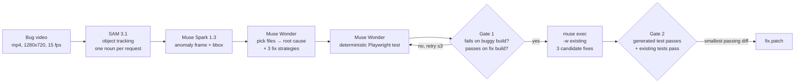

# VisioPatch

**Muse Code can't see. VisioPatch gives it eyes.**

VisioPatch turns a screen recording of a visual web bug into a verified code fix. It tracks what moves with SAM 3.1, asks Muse Spark 1.3 which frame looks wrong, has Muse Wonder name the root cause and write a deterministic Playwright test that fails on the buggy build, then fans out three Muse Code repair attempts in isolated worktrees and keeps only a fix that passes the generated test and the existing suite. It ships as an MCP server plus a Muse Code skill, so a coding agent can debug what it could only read about before.

> Meta Global AI Developer Hackathon · Indie track · Problem statement: **Push the Frontier** · MIT licensed

---

## Deliverables & Report

- **Static Report:** [`report/index.html`](report/index.html) — single offline report with inline SVG pipeline diagram, results table, per-case visual comparison cards, and the `d1` fix diff.
- **Benchmark CSV:** [`report/results.csv`](report/results.csv) — 6-case benchmark breakdown (diagnosis match, suspect-file hit, Gate 1, Gate 2, picked strategy, lines changed).
- **Demo Video Asset:** [`demo/k1174_side_by_side.mp4`](demo/k1174_side_by_side.mp4) — side-by-side labeled video comparison of `k1174` (buggy vs. fixed).
- **Pipeline Diagram Asset:** [`demo/pipeline.png`](demo/pipeline.png) — high-resolution diagram rendered from the report's SVG.

---

## How it works



1. **Capture.** Playwright records the repro page; the webm is transcoded to H.264 MP4 (15 fps, 1280x720) with a `.meta.json` sidecar mapping frames to page time (`visiopatch/capture.py`).
2. **Track.** SAM 3.1 segments each noun phrase (`visiopatch/perceive.py`). If a noun misses, listed `noun_fallbacks` are tried, then three Spark-proposed nouns; all-miss is flagged `EMPTY`, never retried with invented nouns.
3. **Find the anomaly.** Spark 1.3 gets the clip plus a per-second tracks summary and returns the frame and bbox that look wrong (`visiopatch/analyze.py`), blind or with the user's one-line report.
4. **Diagnose.** Wonder picks up to 5 suspect files from the source tree, then diagnoses at high effort: suspect function, test spec, and exactly 3 fix strategies (`visiopatch/rootcause.py`).
5. **Gate 1 (two-phase).** Wonder writes one deterministic pytest-playwright test (`visiopatch/testgen.py`). It must **fail** on the buggy build and **pass** on the fixed build; on failure it is rewritten from the buggy-run output only, max 3 attempts (`scripts/run_gate1.py`).
6. **Repair.** An offline snapshot at the buggy commit gets one `muse exec` candidate per strategy, each in its own worktree using `-w existing` (`visiopatch/repair.py`).
7. **Gate 2.** A candidate counts only if the generated test passes **and** the existing suite does not regress. The smallest passing diff is picked (`scripts/run_repair.py`).

### Packaging

- **MCP server** (`visiopatch.mcp_server`) exposing 8 tools:
  `capture_bug`, `track_objects`, `find_anomaly`, `diagnose`, `generate_visual_test`, `repair_and_verify`, `job_status`, `job_result`
- **Muse Code skill** at `.agents/skills/visual-debug`, which tells Muse Code when and how to call those tools.

---

## Benchmark

Six cases, each a self-contained repro page in `bench/<id>/` with `repro.json` (url, duration ≤5 s, buggy/fix SHAs, noun phrases, a verdict-free one-line report) and `serve.sh` (ports 8901–8906).

| id | source | bug |
|---|---|---|
| `k1174` | kaplayjs/kaplay PR 1174 | momentum not transferred on collision |
| `k950` | kaplayjs/kaplay PR 950 | tall fonts cropped above the em box |
| `k864` | kaplayjs/kaplay PR 864 | one degenerate slice drops the whole 9-slice draw |
| `k658` | kaplayjs/kaplay PR 658 | 9-slice anchored per tile instead of per panel |
| `d1-modal-zindex` | hand-written DOM | modal opens under the sticky header (`transform` on `<main>` traps its z-index) |
| `d2-carousel-drift` | hand-written DOM | carousel cards drift off-centre (rounded cumulative step) |

The four kaplay cases are real merged fixes; `bench/k*/kaplay.js` and `kaplay.fix.js` are bundles built at the pinned SHAs (see `bench/NOTICE.md`). The kaplay repo itself is never vendored.

### Results

| stage | result |
|---|---|
| Spark anomaly detection, blind v1 | **2/6** hits, 2/6 false positives on fixed builds |
| Spark anomaly detection, reported mode | **2/6** hits, 1/6 false positive |
| Wonder root-cause diagnosis | **6/6** |
| Wonder suspect-file hit (vs. files the human fix touched) | **6/6** |
| Gate 1 (test fails on buggy, passes on fix) | **4/6** (k1174, d1, k950, k864) |
| Gate 2 (generated + existing tests pass) | **4/4** of the Gate 1 passes |

On Gate 2: the d1 fix is **byte-identical to the human fix**, and every picked fix touches the same files the human fix changed.

| case | picked strategy | files |
|---|---|---|
| k1174 | momentum impulse in the physics-resolve handler | `src/ecs/components/physics/body.ts` |
| d1 | remove the stacking context from `<main>` | `index.html` |
| k864 | skip only the degenerate slice | `src/ecs/components/draw/sprite.ts` |
| k950 | pad and offset atlas rasterization | `src/core/fontCache.ts`, `src/gfx/formatText.ts` |

Committed evidence: `analysis/<id>/`, `runs/<id>/{rootcause,gate1,gate2}.json`, `runs/<id>/fix.patch`, `tests_generated/test_<id>.py`, `report/results.csv`, `report/index.html`, and the 12 exact repair prompts in `prompts/`.

---

## Honest failures

- **d2:** the generated test also fails on the fixed build, so Gate 1 rejects it and no repair runs.
- **k658:** no generated test ever separates the buggy and fixed builds within 3 attempts.
- **Testgen prompts v1–v4 failed** before the generic v5 prompt worked; the iteration is counted in the cost.
- **Spark confidence carries no signal** (0.85–0.95 on hits, misses and false positives alike), so it gates nothing.
- **SAM vocabulary blind spot:** SAM never tracks the d1 modal or header, through fallbacks and Spark-proposed nouns alike (0 frames). A miss is a vocabulary problem, not a pipeline bug, so SAM frames are recorded, not gated.
- **d1 bench page originally couldn't scroll;** fixed with neutral filler content and Gate 1 re-verified.
- **Live MCP acceptance runs:** [TBD: what they found and the final result].

---

## Leak controls

The benchmark is only meaningful if no model sees the answer.

- **Fix-side output never reaches a model:** no fix SHA, PR text, diffs, `git log`, or generated test source in any prompt. Only the harness switches between buggy and fixed builds.
- **Verdict-free pages:** verdict and cause words are stripped from repro pages and report lines; `tests/test_bench_pages.py` enforces it.
- **Isolated repair:** candidates work on a `git archive` snapshot with one `baseline` commit and no remotes (asserted per case). Acceptance runs use a one-commit demo repo.
- **Contamination scan** of tool-call inputs (fetch/web tools, `curl`, `wget`, `git clone/fetch`, `gh`, `npm view`); no candidate made a web or fetch call.
- **State-label validator:** a generated test may not branch on or name which build it runs against (identifiers or strings like buggy/patched/fix build), so it must judge the page itself.
- Suspect-file hits are scored by the harness only and never enter a prompt.

---

## Cost

About **$5 of $150** in API credits [TBD: final figure]. Results are cached by file sha256 and prompt version, so a clip is never paid for twice. Repair candidates ran through `muse exec` on the Muse subscription ($0 API).

---

## Setup

Tested on Python 3.10 from a clean clone.

```bash
git clone https://github.com/yashvantatk/visiopatch.git && cd visiopatch
python3 -m venv .venv && source .venv/bin/activate
pip install -r requirements.txt
playwright install chromium
unset PYTHONPATH        # only if ROS is installed: its pytest plugins pollute the venv
cp .env.example .env    # then set MODEL_API_KEY=<your Meta API key>. Never commit .env.
```

Check the APIs and run the offline tests:

```bash
.venv/bin/python scripts/smoke.py                    # live: SAM 3.1, Spark 1.3, Wonder, muse exec
env -u PYTHONPATH .venv/bin/python -m pytest        # offline unit tests only, no model calls
```

### Use it from Muse Code

Add the server to Muse's `settings.json` (see [`docs/muse-settings.json`](docs/muse-settings.json)):

```json
{
  "mcpServers": {
    "visiopatch": {
      "command": "/bin/bash",
      "args": ["-c", "cd /absolute/path/to/visiopatch && exec env -u PYTHONPATH /absolute/path/to/visiopatch/.venv/bin/python -m visiopatch.mcp_server"]
    }
  }
}
```

Install the skill:

```bash
muse skills install .agents/skills/visual-debug --scope user
```

### Reproduce the benchmark

```bash
.venv/bin/python scripts/render_check.py            # no models: screenshots both builds of every case
.venv/bin/python scripts/run_perceive.py            # capture + SAM 3.1 tracks
.venv/bin/python scripts/run_analyze.py --mode both # Spark anomaly, blind + reported
.venv/bin/python scripts/run_gate1.py               # Wonder root cause + Gate 1 tests
.venv/bin/python scripts/run_repair.py --only k1174 # Muse Code fan-out + Gate 2
.venv/bin/python scripts/bench.py                  # reads runs & analysis JSONs, writes report/results.csv
```

Every script takes `--only id1,id2` and stops before its projected spend goes over its budget.

---

## Meta models used

| model | role | why it matters |
|---|---|---|
| **SAM 3.1** | video object tracking from a noun phrase | turns pixels into per-frame tracks, so later stages reason about motion and geometry, not just raw frames |
| **Muse Spark 1.3** | video understanding: anomaly frame, noun proposals; repair candidates via `muse exec` | finds *when* and *where* the bug shows up, and writes the fixes cheaply |
| **Muse Wonder** | file picking, root cause, fix strategies, Playwright test generation | the reasoning step: 6/6 diagnoses, and the test that turns "looks wrong" into a pass/fail check |
| **Muse Code** (`muse exec`) | isolated worktree fan-out, MCP client | runs three fixes in parallel without them touching each other, and is the agent the skill gives eyes to |

---

## Built during the hackathon

Built during the hackathon, Oct 26 to Nov 4, 2026. Design decisions and per-step results are in [`PROJECT.md`](PROJECT.md).

## Credits

- [kaplayjs/kaplay](https://github.com/kaplayjs/kaplay) (MIT): the four real bugs and their bundles.
- [Anton](https://github.com/googlefonts/AntonFont) and [Nabla](https://github.com/justvanrossum/nabla) fonts (SIL OFL 1.1), used in `bench/k950`.

Full notices in `bench/NOTICE.md`.

## License

MIT. See [`LICENSE`](LICENSE).